# Lora Sensor

This project measures outdoor and indoor temperature and humidity using two
CircuitPython boards and DHT22 sensors.

The outdoor module:

- reads DHT sensor data
- sends its readings over LoRa to the indoor module.

The indoor module:

- displays outdoor and indoor readings on a 16x2 LCD
- connects to Wi-Fi and publishes the readings to an MQTT broker over TLS
- it includes sensor, radio, and connection errors in the MQTT status message.

The outdoor module only needs the LoRa link to send its measurements. Wi-Fi and
MQTT are handled by the indoor module.

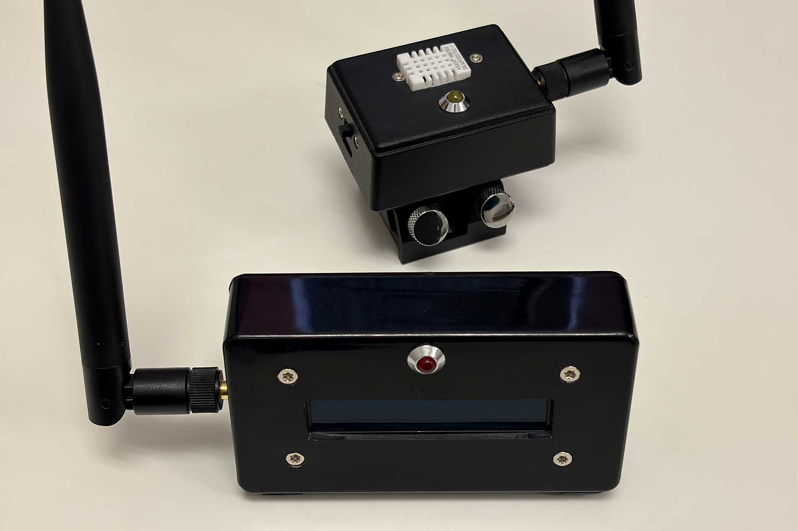

## The build process

For this project, I built two separate units, each with:

- a CircuitPython board
- an RFM9x-compatible 868 MHz LoRa radio with a suitable antenna
- a DHT22 sensor on a breakout board
- an external status LED with a 220 Ω series resistor.

The indoor board also needed Wi-Fi support,
and I added a 16x2 character LCD with a PCF8574 I2C backpack to show the readings.

I wrote the code using Raspberry Pi Pico-style `GP` pin names and CircuitPython.
A Pico W or Pico 2 W is suitable for the indoor unit; the outdoor unit does not
need Wi-Fi.

To put the units together, I soldered the headers and wired the components to
the GPIO pins listed in the tables below. These numbers refer to the board's
GPIO labels, not physical header pin numbers.

I used a common ground within each unit and powered the radios and DHT22 sensors
from 3.3 V, keeping the GPIO signals at 3.3 V levels. Each status LED connects
from GP5 through a 220 Ω series resistor to its anode, with its cathode connected to
GND. I used DHT22 breakout boards with an onboard pull-up resistor and capacitor,
so I did not need to add a separate pull-up resistor.

I connected the LCD backpack's SDA and SCL lines directly to the indoor board.

## Outdoor And Indoor Modules

The python code is split between [outdoor_module](outdoor_module/) and
[indoor_module](indoor_module/). Copy each directory's contents to its respective
board, preserving its `lib/` directory.

Both radios use the same settings:

- frequency: 868 MHz
- transmit power: 13 dBm
- bandwidth: 125 kHz
- spreading factor: 7
- coding rate: 4/5
- preamble length: eight symbols
- CRC: enabled.

If you change the radio settings, keep them consistent on both boards.

The outdoor device ID must match the ID configured indoors. The indoor module
ignores packets with another ID, malformed messages, and measurements outside
the DHT22 ranges of -40 to 80 degrees Celsius and 0 to 100 percent humidity.

### Outdoor module

The outdoor module reads its DHT22 and sends a JSON message containing
`device_id`, `temperature`, and `humidity`. Temperature is measured in degrees Celsius and
humidity in percent.

The required parts are:

- a CircuitPython board with the GPIO pins listed below
- an RFM9x-compatible 868 MHz LoRa radio and antenna
- a DHT22 sensor on a breakout board
- an LED and 220 Ω series resistor
- a power supply and wiring.

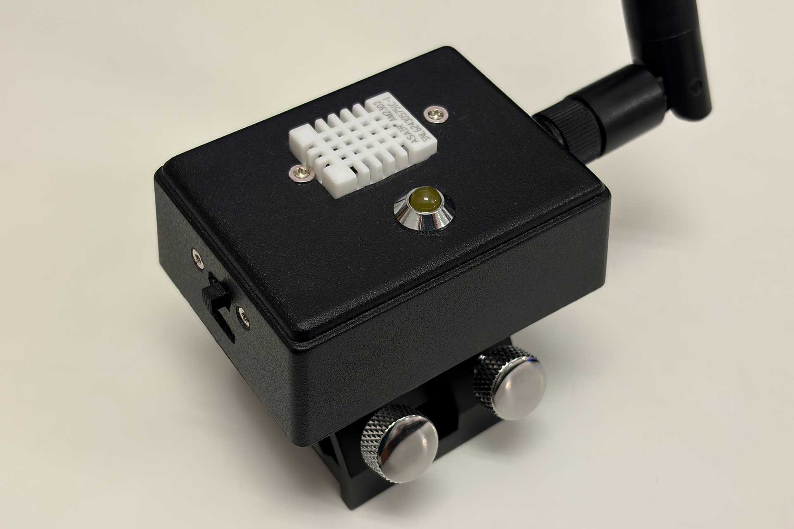

Connect or solder the signal wires as follows:

| Component signal | Board GPIO |
| --- | --- |
| Radio SCK | GP18 |
| Radio MOSI | GP19 |
| Radio MISO | GP16 |
| Radio CS / NSS | GP17 |
| Radio RST | GP20 |
| DHT22 DATA | GP4 |
| Status LED through a 220 Ω resistor | GP5 |

Connect the radio and sensor supply pins to 3.3 V and their ground pins to GND.
The code does not use a radio DIO interrupt pin.

The following photos show the outdoor module internals:

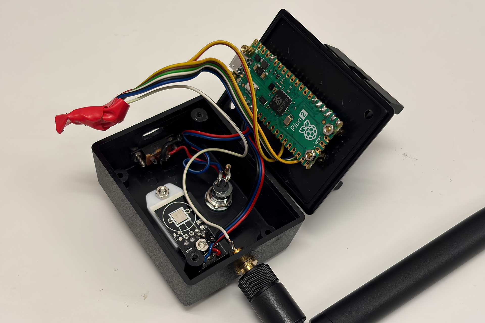

Close up photo of the internals:

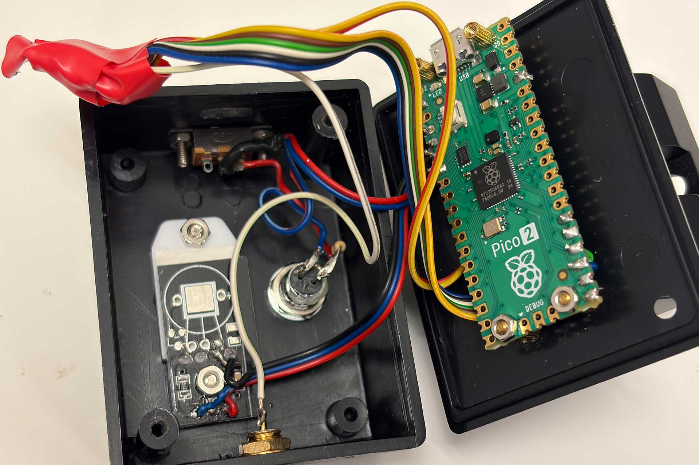

The code files are:

- `outdoor_module.py` - defines `OutdoorModule`, initializes the hardware, reads
  the sensor, and transmits measurements in `run()`
- `code.py` - creates the module with its device ID and starts `run()`
- `lib/` - contains the Adafruit RFM9x and DHT drivers.

The LED signals are:

- two flashes after a successful transmission
- ten flashes after a sensor read or transmission error, followed by a
  five-second wait before the next attempt
- continuous flashing if radio or sensor initialization fails; normal operation
  stops until the board is reset.

### Indoor module

The indoor module receives outdoor readings, reads its own DHT22 at most once
every ten seconds, and updates the LCD when new measurements are available.
The top row shows outdoor temperature and humidity; the bottom row shows
indoor temperature and humidity. The display starts with placeholders until
readings arrive.

Front view of the indoor module:

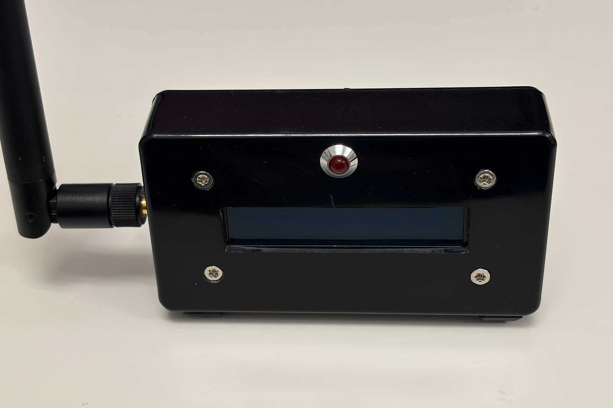

Back face:

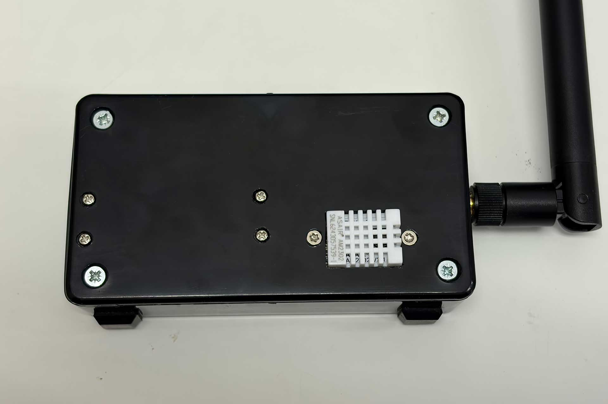

The required parts are:

- a Wi-Fi-capable CircuitPython board with the GPIO pins listed below
- an RFM9x-compatible 868 MHz LoRa radio and antenna
- a DHT22 sensor on a breakout board
- a 16x2 character LCD with a PCF8574 I2C backpack at address `0x27`
- an LED and 220 Ω series resistor
- a power supply and wiring.

Connect or solder the signal wires as follows:

| Component signal | Board GPIO |
| --- | --- |
| Radio SCK | GP18 |
| Radio MOSI | GP19 |
| Radio MISO | GP16 |
| Radio CS / NSS | GP17 |
| Radio RST | GP20 |
| DHT22 DATA | GP14 |
| LCD SDA | GP0 |
| LCD SCL | GP1 |
| Status LED through a 220 Ω resistor | GP5 |

Connect the radio and sensor supply pins to 3.3 V and their ground pins to GND.
Connect the LCD backpack's SDA and SCL lines directly to the GPIO pins listed
above, and connect its power and ground. The code does not use a radio DIO
interrupt pin.

The following photos show the indoor module internals:

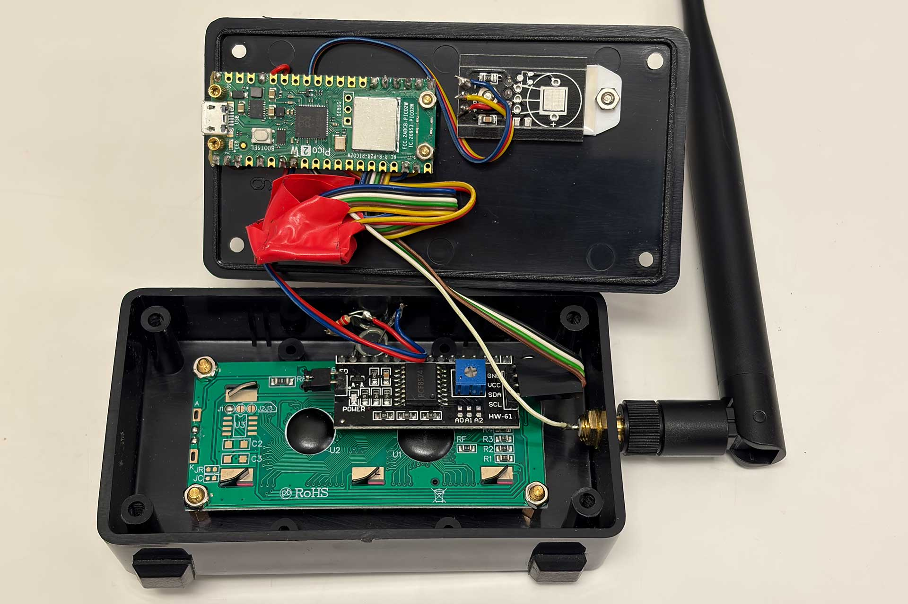

Close up view of the internals:

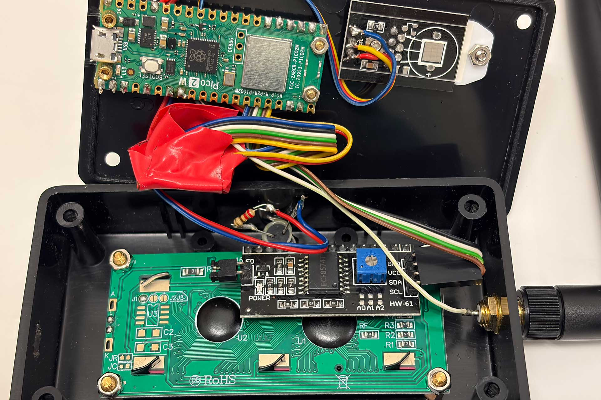

The code files are:

- `indoor_module.py` - defines `IndoorModule` class and handles the radio, sensor,
  display, MQTT publications, and error reporting
- `wifi_connection.py` - manages the Wi-Fi connection and retries
- `config.py` - provides Wi-Fi, MQTT, and LoRa device settings
- `code.py` - creates the module and starts `run()`
- `lib/` - contains the radio, DHT, MQTT, connection manager, ticks, and
  [CircuitPython LCD](https://github.com/dhalbert/CircuitPython_LCD) libraries.

Copy `config.py` to `config_local.py` on the indoor board and edit the copy.
The code files load `config_local.py` first and fall back to `config.py` if the
local file is absent. You can also edit `config.py` directly.

| Setting | What to provide |
| --- | --- |
| `wifi_ssid` | Wi-Fi network name |
| `wifi_password` | Wi-Fi password |
| `mqtt_server` | MQTT broker hostname |
| `mqtt_port` | Broker's TLS port; the supplied default is `8883` |
| `mqtt_username` | MQTT username |
| `mqtt_password` | MQTT password |
| `mqtt_topic` | Topic for measurement and status messages |
| `mqtt_publish_interval` | Minimum time between publications, in seconds; default `120` |
| `lora_device_id` | Outdoor device ID to accept; default `lora_sensor_1` |

The MQTT client uses TLS. Configure a broker endpoint that supports it. Messages
contain:

- `indoor_temperature`
- `indoor_humidity`
- `outdoor_temperature`
- `outdoor_humidity`
- `status`.

Measurements that have not yet been received or read are published as JSON `null`.

The module retries Wi-Fi and MQTT connections with ten-second retry delays.
It reports an error if no valid outdoor measurement arrives for two minutes.
The last outdoor readings remain available on the display and in MQTT messages,
so check `status` to identify missing updates. Network errors are retained until
they can be included in a successful MQTT publication.

The LED signals are:

- two quick flashes after accepting an outdoor reading
- ten quick flashes after a successful Wi-Fi connection
- six slower flashes after an unsuccessful Wi-Fi connection attempt
- continuous flashing if radio initialization fails, stopping normal operation
  until reset.

Sensor and LCD errors are logged and included in MQTT status messages. The
code files continue running if either of these components fails to initialize;
sensor initialization is retried during subsequent indoor read attempts.

## How to run it

1. Install CircuitPython on each board. Use library `.mpy` files compatible with
   the installed CircuitPython major version; replace the bundled files with
   matching versions if necessary.
2. Copy the contents of `outdoor_module/` to the outdoor board's `CIRCUITPY`
   drive. Its root should contain `code.py`, `outdoor_module.py`, and `lib/`.
3. Copy the contents of `indoor_module/` to the indoor board's `CIRCUITPY` drive.
   Its root should contain `code.py`, `indoor_module.py`, `wifi_connection.py`,
   `config.py`, and `lib/`.
4. Create and edit `config_local.py` on the indoor board as described above.
   Enter your Wi-Fi and MQTT details.
5. Match the outdoor device ID to the indoor `lora_device_id`. The supplied
   outdoor `code.py` uses:

   ```python
   from outdoor_module import OutdoorModule

   outdoor = OutdoorModule(device_id = 'lora_sensor_1')
   outdoor.run()
   ```

6. Save the files and reset both boards. CircuitPython automatically runs the
   root `code.py` when the board starts. The indoor entry point is:

   ```python
   from indoor_module import IndoorModule

   indoor = IndoorModule()
   indoor.run()
   ```

Once running, the indoor LCD should show local readings and then outdoor
readings as LoRa messages arrive. Subscribe to the configured MQTT topic to
see the combined measurements and status. Serial console output on each board
shows initialization, transmitted or received messages, and errors.

## More photos of the project

Here are some photos of the completed project:

General overview:

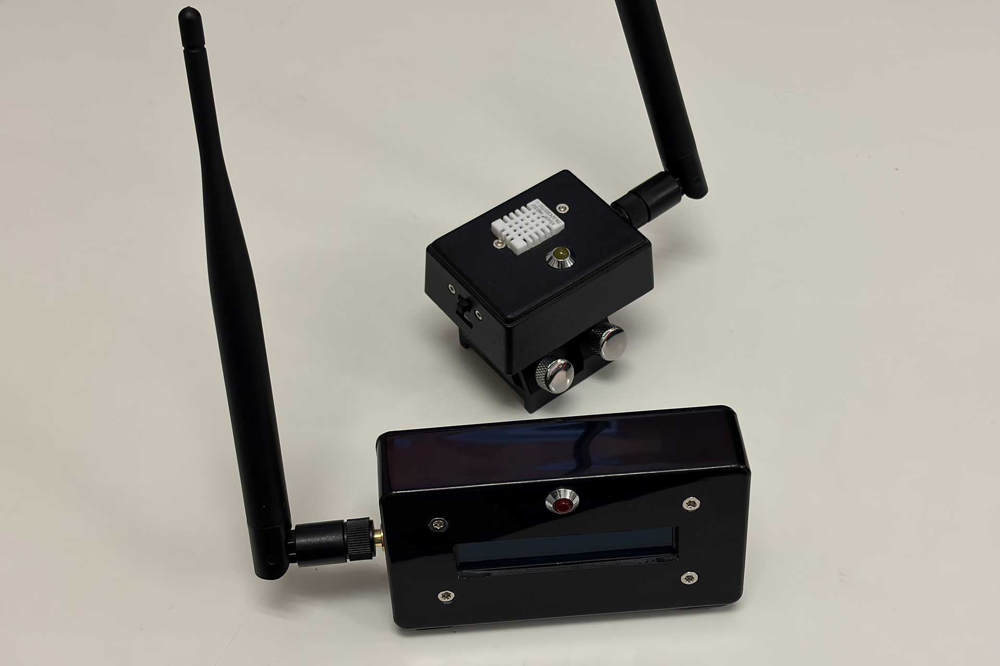

Antennas are quite long:

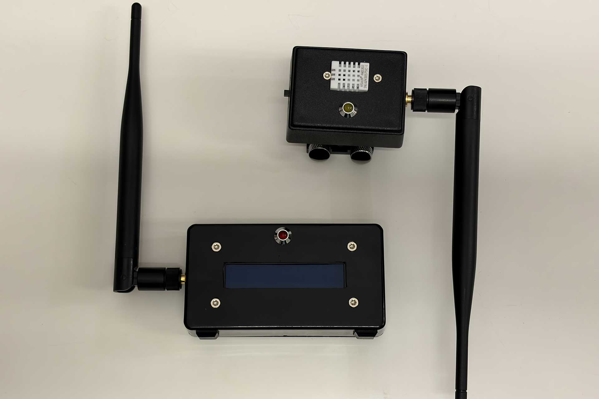

The functioning project:

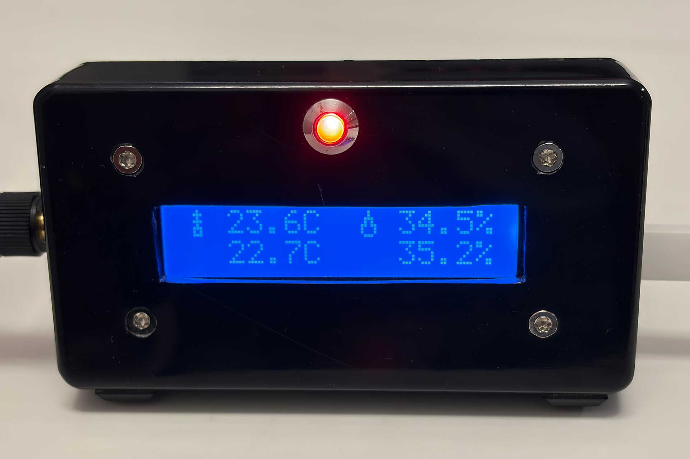

## Final thoughts

If you have any questions, feel free to ask me.